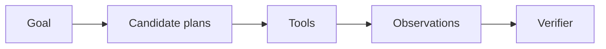

# 7.3 — Verification and Critique

<p class="study-position" data-course="07-reasoning-and-tool-use" data-lecture="03-verification-and-critique.md">Verification and tool contracts · Lecture 3 of 6</p>

[← Planning](02-planning.md) · [Course outline](index.md#course-outline){ .study-overview } · [Tools as Capability Boundaries →](04-tools-as-capability-boundaries.md)
{: .study-directions }

??? note "Jump to a lecture"

    **Search and planning**

    - [Reasoning as Search](01-reasoning-as-search.md)
    - [Planning](02-planning.md)

    **Verification and tool contracts**

    - **Verification and Critique** (current)
    - [Tools as Capability Boundaries](04-tools-as-capability-boundaries.md)

    **Integrations and reasoning cost**

    - [MCP and Integration Protocols](05-mcp-and-integration-protocols.md)
    - [Reasoning-System Economics](06-reasoning-system-economics.md)

*Read 25 min · Worked example 20 min · Code/design practice 45–60 min · Review 10 min*

[Download the course notebook](../../assets/notebooks/07-reasoning-and-tool-use.ipynb){ download } · Use the exercise under **Lecture 03**.

## Before you begin

- Courses 01 and 04–06 or equivalent experience
- Search and planning
- Typed software interfaces

## Why this chapter exists

Use deterministic checks, tests, rubrics, critics, self-consistency, best-of-N, and external evidence.

## A second pass needs independent evidence

A model proposes that a permit requirement has been met. Asking the same model if it agrees produces agreement even when the official record is missing.

Verify against a rule or a separate evidence source. Keep proposal and verification outcomes separate, and make one test where fluent wording accompanies missing proof.

## Learning objectives

- Explain why verification and critique matters using the chapter scenario, not abstract definitions alone.
- Trace how **verifiers** and **critique** interact in the book-level visual.
- Implement or design the bounded practice while holding evaluation cases fixed.
- Diagnose at least two failure modes specific to tests.
- Decide where this chapter's mechanism belongs in a production architecture and what evidence justifies it.

!!! note "Enduring principle"
    Verification should exploit signals different from those used to generate the answer.

## Mental model



## Core concepts

The concepts form a system, not a vocabulary list. Read each section below before attempting the practice exercise.

### Verifiers

Verifiers check candidate outputs with independent logic—unit tests, schemas, calculators—not the same model that generated them. See the [Verifiers concept card](../../concepts/cards/verifiers.md).

**Example:** A Python assert verifies JSON plan steps include all required migration phases.

**Evidence of understanding:** Report verifier catch rate on intentionally corrupted candidate outputs.

### Critique

Critique models or rubrics evaluate drafts and suggest fixes before finalization. Separating generation from critique reduces shared blind spots. See the [Critique concept card](../../concepts/cards/critique.md).

**Example:** A critic flags unsupported claims in a research draft before user delivery.

**Evidence of understanding:** Measure error reduction with generate-then-critique versus single-pass on 50 tasks.

### Self-Consistency

Self-consistency samples multiple reasoning paths and aggregates answers by majority vote. It improves reliability when individual samples are noisy. See the [Self-Consistency concept card](../../concepts/cards/self-consistency.md).

**Example:** Five chain-of-thought samples that agree on '42' outweigh one outlier '41'.

**Evidence of understanding:** Compare accuracy of majority vote versus single sample at equal total token budget.

### best-of-N

Best-of-N generates N candidates and selects the best by a scorer or verifier. Quality rises with N but so do cost and latency. See the [best-of-N concept card](../../concepts/cards/best-of-n.md).

**Example:** Generate ten JSON plans; pick the one passing all schema and dependency checks.

**Evidence of understanding:** Plot task success versus N and identify diminishing returns knee.

### Tests

Tests provide executable specifications for tools, plans, and outputs in reasoning pipelines. They turn vague correctness into pass/fail signals. See the [Tests concept card](../../concepts/cards/tests.md).

**Example:** A migration plan test asserts rollback step exists before destructive changes.

**Evidence of understanding:** Run test suite on every candidate plan and require 100% pass before execution.

## Worked example

**Book scenario:** A research workflow must plan, call tools, and reject unsupported conclusions.

**Situation:** The workflow generates three draft answers; one sounds best but cites nonexistent sections.

**Baseline:** Pick the most fluent candidate by model self-rank.

**Application:** Generate N candidates, score with independent verifier (citation overlap, unit tests on claims, rubric checklist), select best-of-N, reject all if none pass threshold.

**Test cases:** (1) Normal: one candidate fully verified. (2) Boundary: tie scores within noise. (3) Adversarial: fluent answer failing citation check.

**Measurement:** Verifier precision, gain over single-sample, extra latency/token cost.

**Design question:** Why must verification use signals different from generation?

## Follow the code

Run this short Python demonstration of **verification and critique**. Identify the input, the decision or calculation, and the printed result.

```python
candidates = [
    {"text": "Cap is 240", "cite_ok": True, "score": 0.7},
    {"text": "Cap is 300", "cite_ok": False, "score": 0.9},
]
def select(cands):
    passing = [c for c in cands if c["cite_ok"]]
    return max(passing, key=lambda c: c["score"]) if passing else None
print("selected:", select(candidates))
```

Predict the result before you run it. Change one input, then explain the resulting difference using the mechanism from the worked example.

For a longer implementation, run the [course code sample](../../code-samples/07-planner-verifier.py). Only the plan containing every required step in dependency order should pass verification.

## Engineering practice

**Build:** Generate several candidates and select with an independent verifier.

Work in three passes tailored to this chapter:

1. **Baseline:** Implement the task without verifiers and record quality, latency, and failure cases.
2. **Mechanism:** Add critique while keeping inputs and evaluation fixed; note what changed in intermediate state.
3. **Judgment:** Compare outcomes on normal, boundary, and adversarial cases; document when verification and critique earns its operational cost.

Capture assumptions, test cases, results, and one architecture decision record. A successful lab explains *why* behavior changed, not merely that the program ran.

**Section checkpoint**

Pass a complete plan and then swap two dependent steps. Compare the verifier's decisions.

Compare your prediction with the chapter demonstration and explain which input changed the result. The [course notebook](../../assets/notebooks/07-reasoning-and-tool-use.ipynb){ download } contains the runnable examples and a checked experiment. See [notebook setup](../../labs/notebooks/index.md) if you are new to Jupyter.

## Spec-driven habit

Every chapter lab pairs reading with **executable acceptance**. Before implementing book 7.3 — verification and critique:

1. Draft cases in `test_lab.py` or `specs/lab-0703.yaml`.
2. Use [Cursor Plan/Agent](https://cursor.com/) with "read spec first, then minimal diff".
3. Or use [OpenSpec](https://openspec.dev/) `/opsx:propose` so requirements live in `openspec/` next to code.

→ [Spec-driven workflow guide](../../getting-started/spec-driven-workflow.md) · [Lab 7.3](../../labs/0703-verification-and-critique.md)


## Architecture lens

For a production design in **Reasoning and Tool Use**, make the following explicit for **verification and critique**:

| Concern | Question to answer |
|---|---|
| **Ownership** | Which service owns verifiers versus downstream consumers of its output? |
| **Contract** | What typed inputs, outputs, errors, and version does the self-consistency boundary expose? |
| **Evidence** | Which eval slices prove verification and critique meets requirements before and after each release? |
| **Security** | What untrusted data crosses the tests boundary and how is it sanitized or authorized? |
| **Operations** | What is logged at this chapter's transition, what triggers retry or rollback, and what is cached? |
| **Economics** | Which resource—tokens, retrieval calls, GPU seconds, human review—dominates cost for this mechanism? |

## Failure clinic

Reproduce failures at the chapter boundary—do not debug only final output.

| Failure | Symptom | Likely cause | First response |
|---|---|---|---|
| **Baseline illusion** | The system looks fine on demo prompts but fails on the book scenario | Evaluation cases do not cover verifiers or critique | Add the chapter's normal, boundary, and adversarial cases before tuning |
| **Mechanism mismatch** | Adding complexity does not improve the measured outcome | verification and critique is applied at the wrong layer or without fixing inputs | Trace the book visual and verify the transition this chapter owns |
| **Silent degradation** | Outputs remain fluent while decisions become wrong | Failure in tests without observability at that boundary | Log intermediate state, version config, and compare against the baseline |
| **Operational drift** | Quality changes after deploy though prompts are unchanged | Data, permissions, or upstream verifiers behavior shifted | Pin versions, inspect ingestion and policy filters, re-run slice evals |

Use deterministic checks, tests, rubrics, critics, self-consistency, best-of-N, and external evidence. When triaging, preserve full inputs, retrieved evidence, tool traces, and model or index versions.

## Evolution lens

- **Yesterday:** Manual playbooks, brittle rules, or single-pass models handled parts of verification and critique without explicit verifiers.
- **Today:** Engineering teams implement verification and critique as testable components with baselines, typed boundaries, and stage-specific evaluation.
- **Tomorrow:** Better automation may reduce toil, but tests and governance constraints will still require explicit design.
- **What survives:** Verification should exploit signals different from those used to generate the answer.

## Knowledge check

1. Why should verification differ from generation signals?
2. When does self-consistency fail?
3. What baseline picks first candidate?

??? question "Answer guidance"
    Q1: Generator optimizes fluency; verifier checks external criteria. Q2: All samples share same hallucination mode. Q3: Single pass with no independent checks.

## Mastery questions

??? tip "Model answers (proficient level)"
        1. **Explain verifiers without jargon and give a counterexample.**
       *Proficient answer:* verifiers check candidate outputs with independent logic—unit tests, schemas, calculators—not the same model that generated them. Counterexample: applying it when the task is fully deterministic and cheaper to hard-code.
    2. **Compare critique with tests using quality, cost, latency, and risk.**
       *Proficient answer:* critique models or rubrics evaluate drafts and suggest fixes before finalization; tests provide executable specifications for tools, plans, and outputs in reasoning pipelines. Trade quality gains against operational and security cost on the chapter scenario.
    3. **Design a minimal experiment that tests the chapter's central claim.**
       *Proficient answer:* Fix a baseline and three cases (normal, boundary, adversarial). Add only the chapter mechanism, measure one task metric plus cost/latency, and pre-register what result would falsify the claim.
    4. **Identify which component should own validation, authorization, and observability.**
       *Proficient answer:* Validation belongs at the typed boundary after critique; authorization before any side effect or retrieval of restricted data; observability at the transition verification and critique introduces in the book visual.
    5. **State what would remain true if today's leading libraries and vendors disappeared.**
       *Proficient answer:* Verification should exploit signals different from those used to generate the answer.

## Self-assessment rubric

| Level | Evidence |
|---|---|
| Not yet | Can repeat terms but cannot trace the visual or predict the sample. |
| Developing | Can explain the mechanism and complete the normal case with help. |
| Proficient | Can implement the exercise, diagnose a failure, and compare a baseline. |
| Transfer | Can defend an architecture choice in a new domain with evaluation evidence. |

## Evidence and further study

- Yao et al. — ReAct
- Primary protocol specifications for the tool interfaces studied

## Continue

[← Planning](02-planning.md) · [Course outline](index.md#course-outline){ .study-overview } · [Tools as Capability Boundaries →](04-tools-as-capability-boundaries.md)
{: .study-directions .study-directions--footer }
