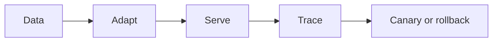

# 11.6 — LLMOps

<p class="study-position" data-course="11-training-serving-and-ai-operations" data-lecture="06-llmops.md">Deployment and operations · Lecture 6 of 6</p>

[← Deployment and Routing](05-deployment-and-routing.md) · [Course outline](index.md#course-outline){ .study-overview } · [Course project →](index.md#course-project)
{: .study-directions }

??? note "Jump to a lecture"

    **Model adaptation and post-training**

    - [Choosing Adaptation](01-choosing-adaptation.md)
    - [Post-Training Methods](02-post-training-methods.md)

    **Datasets and inference infrastructure**

    - [Dataset Engineering](03-dataset-engineering.md)
    - [Inference Infrastructure](04-inference-infrastructure.md)

    **Deployment and operations**

    - [Deployment and Routing](05-deployment-and-routing.md)
    - **LLMOps** (current)

*Read 25 min · Worked example 20 min · Code/design practice 45–60 min · Review 10 min*

[Download the course notebook](../../assets/notebooks/11-training-serving-and-ai-operations.ipynb){ download } · Use the exercise under **Lecture 06**.

## Before you begin

- Courses 02, 04, and 10 or equivalent experience
- Containers and APIs
- Performance measurement

## Why this chapter exists

Version prompts, models, data, and evals; trace requests; monitor quality and cost; canary, roll back, and respond to incidents.

## Ask where the regression entered the pipeline

Operations sees fewer correct citations after a release. The checkpoints, quantization, and document index were all updated together.

Record all relevant versions and change them separately where possible. Compare slices and retrieve-stage evidence before restoring the right artifact or rerouting to the prior configuration.

## Learning objectives

- Explain why llmops matters using the chapter scenario, not abstract definitions alone.
- Trace how **tracing** and **versioning** interact in the book-level visual.
- Implement or design the bounded practice while holding evaluation cases fixed.
- Diagnose at least two failure modes specific to finops.
- Decide where this chapter's mechanism belongs in a production architecture and what evidence justifies it.

!!! note "Enduring principle"
    Every production change needs evidence, observability, and a reversible release path.

## Mental model



## Core concepts

The concepts form a system, not a vocabulary list. Read each section below before attempting the practice exercise.

### Tracing

Tracing records spans for retrieval, model calls, tools, and validation with correlation IDs across services. See the [Tracing concept card](../../concepts/cards/tracing.md).

**Example:** OpenTelemetry trace shows 400ms in reranker, 1.2s in LLM for slow request diagnosis.

**Evidence of understanding:** Sample traces link 100% of P0 incidents to span breakdown within five minutes.

### Versioning

Versioning tracks prompts, models, indexes, and eval suites so changes are attributable and reversible. See the [Versioning concept card](../../concepts/cards/versioning.md).

**Example:** Prod trace includes prompt v3.1, model llama-3-8b-q4, index 2024-06-01.

**Evidence of understanding:** Rollback drill: revert one version dimension and restore prior metric within one hour.

### Continuous Evaluation

Continuous evaluation runs production or shadow traffic against eval suites to detect drift post-release. See the [Continuous Evaluation concept card](../../concepts/cards/continuous-evaluation.md).

**Example:** Nightly job scores 500 sampled prod queries with LLM judge against rubric.

**Evidence of understanding:** Alert when rolling 7-day faithfulness drops below threshold versus launch baseline.

### Canaries

Canaries route small traffic percentage to new versions before full rollout. See the [Canaries concept card](../../concepts/cards/canaries.md).

**Example:** 5% traffic to new embedding index for 24h comparing recall and latency.

**Evidence of understanding:** Auto-rollback canary if error rate or primary metric degrades beyond bound.

### FinOps

FinOps tracks and optimizes AI spend—tokens, GPU hours, API fees—against business value. See the [FinOps concept card](../../concepts/cards/finops.md).

**Example:** Dashboard shows cost per successful ticket deflection by model route.

**Evidence of understanding:** Monthly review: top three cost drivers and optimization actions with owner.

## Worked example

**Book scenario:** A service must route requests across models while controlling cost and retaining rollback.

**Situation:** Production traces show occasional wrong answers after retrieval provider blips; finance wants cost attribution per feature.

**Baseline:** Logs only final response text.

**Application:** Instrument full request trace (model version, retrieval latency, validation outcome), inject failure drills for provider/retrieval/validation, canary releases with automatic rollback on eval regression.

**Test cases:** (1) Normal: full trace captured. (2) Boundary: partial trace when tool times out. (3) Adversarial: validation bypass bug ships in canary.

**Measurement:** MTTR on injected failures, trace completeness %, cost per successful request by stage.

**Design question:** Which signal triggers rollback fastest with lowest false positives?

## Follow the code

Run this short Python demonstration of **llmops**. Identify the input, the decision or calculation, and the printed result.

```python
CHAPTER = "11.6"
print("chapter hook:", CHAPTER)
canary = {"success_rate": 0.79, "baseline": 0.85, "threshold": -0.03}
delta = canary["success_rate"] - canary["baseline"]
action = "rollback" if delta < canary["threshold"] else "promote"
print({"delta": round(delta, 3), "action": action})
print("---")
print("change one input above, predict output, re-run")
```

Predict the result before you run it. Change one input, then explain the resulting difference using the mechanism from the worked example.

For a longer implementation, run the [course code sample](../../code-samples/11-model-router.py). Low-risk simple work routes to the cheaper model; high-risk work routes to the higher-quality model.

## Engineering practice

**Build:** Instrument a request and inject provider, retrieval, and validation failures.

Work in three passes tailored to this chapter:

1. **Baseline:** Implement the task without tracing and record quality, latency, and failure cases.
2. **Mechanism:** Add versioning while keeping inputs and evaluation fixed; note what changed in intermediate state.
3. **Judgment:** Compare outcomes on normal, boundary, and adversarial cases; document when llmops earns its operational cost.

Capture assumptions, test cases, results, and one architecture decision record. A successful lab explains *why* behavior changed, not merely that the program ran.

**Section checkpoint**

Compare routing choices and write a rollback trigger in terms of latency and quality.

Compare your prediction with the chapter demonstration and explain which input changed the result. The [course notebook](../../assets/notebooks/11-training-serving-and-ai-operations.ipynb){ download } contains the runnable examples and a checked experiment. See [notebook setup](../../labs/notebooks/index.md) if you are new to Jupyter.

## Spec-driven habit

Every chapter lab pairs reading with **executable acceptance**. Before implementing book 11.6 — llmops:

1. Draft cases in `test_lab.py` or `specs/lab-1106.yaml`.
2. Use [Cursor Plan/Agent](https://cursor.com/) with "read spec first, then minimal diff".
3. Or use [OpenSpec](https://openspec.dev/) `/opsx:propose` so requirements live in `openspec/` next to code.

→ [Spec-driven workflow guide](../../getting-started/spec-driven-workflow.md) · [Lab 11.6](../../labs/1106-llmops.md)


## Architecture lens

For a production design in **Training, Serving, and AI Operations**, make the following explicit for **llmops**:

| Concern | Question to answer |
|---|---|
| **Ownership** | Which service owns tracing versus downstream consumers of its output? |
| **Contract** | What typed inputs, outputs, errors, and version does the continuous evaluation boundary expose? |
| **Evidence** | Which eval slices prove llmops meets requirements before and after each release? |
| **Security** | What untrusted data crosses the finops boundary and how is it sanitized or authorized? |
| **Operations** | What is logged at this chapter's transition, what triggers retry or rollback, and what is cached? |
| **Economics** | Which resource—tokens, retrieval calls, GPU seconds, human review—dominates cost for this mechanism? |

## Failure clinic

Reproduce failures at the chapter boundary—do not debug only final output.

| Failure | Symptom | Likely cause | First response |
|---|---|---|---|
| **Baseline illusion** | The system looks fine on demo prompts but fails on the book scenario | Evaluation cases do not cover tracing or versioning | Add the chapter's normal, boundary, and adversarial cases before tuning |
| **Mechanism mismatch** | Adding complexity does not improve the measured outcome | llmops is applied at the wrong layer or without fixing inputs | Trace the book visual and verify the transition this chapter owns |
| **Silent degradation** | Outputs remain fluent while decisions become wrong | Failure in finops without observability at that boundary | Log intermediate state, version config, and compare against the baseline |
| **Operational drift** | Quality changes after deploy though prompts are unchanged | Data, permissions, or upstream tracing behavior shifted | Pin versions, inspect ingestion and policy filters, re-run slice evals |

Version prompts, models, data, and evals; trace requests; monitor quality and cost; canary, roll back, and respond to incidents. When triaging, preserve full inputs, retrieved evidence, tool traces, and model or index versions.

## Evolution lens

- **Yesterday:** Manual playbooks, brittle rules, or single-pass models handled parts of llmops without explicit tracing.
- **Today:** Engineering teams implement llmops as testable components with baselines, typed boundaries, and stage-specific evaluation.
- **Tomorrow:** Better automation may reduce toil, but finops and governance constraints will still require explicit design.
- **What survives:** Every production change needs evidence, observability, and a reversible release path.

## Knowledge check

1. Why must production changes be reversible with evidence?
2. What does tracing enable beyond debugging?
3. What LLMOps baseline lacks versioning?

??? question "Answer guidance"
    Q1: Regressions happen; rollback limits blast radius. Q2: Cost attribution, stage failures, audit. Q3: Deploy latest prompt/model with no canary.

## Mastery questions

??? tip "Model answers (proficient level)"
        1. **Explain tracing without jargon and give a counterexample.**
       *Proficient answer:* tracing records spans for retrieval, model calls, tools, and validation with correlation ids across services. Counterexample: applying it when the task is fully deterministic and cheaper to hard-code.
    2. **Compare versioning with FinOps using quality, cost, latency, and risk.**
       *Proficient answer:* versioning tracks prompts, models, indexes, and eval suites so changes are attributable and reversible; finops tracks and optimizes ai spend—tokens, gpu hours, api fees—against business value. Trade quality gains against operational and security cost on the chapter scenario.
    3. **Design a minimal experiment that tests the chapter's central claim.**
       *Proficient answer:* Fix a baseline and three cases (normal, boundary, adversarial). Add only the chapter mechanism, measure one task metric plus cost/latency, and pre-register what result would falsify the claim.
    4. **Identify which component should own validation, authorization, and observability.**
       *Proficient answer:* Validation belongs at the typed boundary after versioning; authorization before any side effect or retrieval of restricted data; observability at the transition llmops introduces in the book visual.
    5. **State what would remain true if today's leading libraries and vendors disappeared.**
       *Proficient answer:* Every production change needs evidence, observability, and a reversible release path.

## Self-assessment rubric

| Level | Evidence |
|---|---|
| Not yet | Can repeat terms but cannot trace the visual or predict the sample. |
| Developing | Can explain the mechanism and complete the normal case with help. |
| Proficient | Can implement the exercise, diagnose a failure, and compare a baseline. |
| Transfer | Can defend an architecture choice in a new domain with evaluation evidence. |

## Evidence and further study

- Hu et al. — LoRA
- Ouyang et al. — InstructGPT
- Official inference-server documentation

## Continue

[← Deployment and Routing](05-deployment-and-routing.md) · [Course outline](index.md#course-outline){ .study-overview } · [Course project →](index.md#course-project)
{: .study-directions .study-directions--footer }
