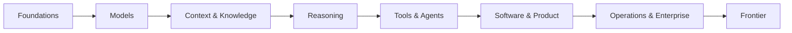

# AI Engineering Body of Knowledge

**A durable, open curriculum for understanding, building, evaluating, and operating AI systems.**

AIEBOK teaches principles before products and makes implementation, architecture, trade-offs, and evolution explicit in every knowledge area.

[Choose a learning path](getting-started/learning-paths/index.md){ .md-button .md-button--primary }
[Browse courses](courses/index.md){ .md-button }

Start with **AI for Everyone** or **AI for Managers and Product Leaders** if you want to learn without coding. Technical paths start with software engineering and progress through specialist and advanced practice.

## Publication at a glance

<!-- site-stats:publication:start -->
- 14 role-based learning paths
- 29 courses · 142 lectures
- 23 downloadable course workbooks · 5 starter notebooks
- 20 knowledge-area maps
- 163 topic guides (120 knowledge-area + 43 supplemental)
- 361 concept cards (43 featured deep-dives)
- 100 patterns (98 catalog + 2 starter deep-dives)
- 25 architecture studios
- 13 build guides · 26 cloud capability guides
- 83 labs (78 chapter + 5 starter) · 13 code samples
- approximately 404,000 words of deployable learning content in `docs/`
<!-- site-stats:publication:end -->

## Explore the curriculum

<!-- site-stats:home-cards:start -->

-   :material-map-legend:{ .lg .middle } __Start with orientation__

    Choose a role-based path from no-code AI literacy to advanced engineering.

    [Learning paths →](getting-started/learning-paths/index.md)

-   :material-book-open-variant:{ .lg .middle } __Read sequentially__

    29 courses with sectioned lectures, practice, and projects.

    [Course catalog →](courses/index.md)

-   :material-flask:{ .lg .middle } __Build hands-on__

    23 course workbooks and 5 starter notebooks.

    [Jupyter notebooks →](labs/notebooks/index.md)

-   :material-card-search:{ .lg .middle } __Look up fast__

    361 concept cards, 100 patterns, 25 architecture studios.

    [Concept index →](concepts/index.md)

-   :material-school:{ .lg .middle } __Explore by topic__

    163 topic guides linked to the curriculum.

    [Topic index →](lessons/index.md)

-   :material-cloud:{ .lg .middle } __Design for production__

    Patterns, cloud maps, and 13 build guides.

    [Pattern library →](patterns/index.md)

<!-- site-stats:home-cards:end -->

## The whole field, one map

## What makes this different

- **Enduring theory:** concepts expected to outlive current libraries.
- **Modern engineering:** current ways of implementing those concepts.
- **Code practice:** build important mechanisms once, then use mature tools.
- **Architecture studios:** reason about scale, safety, cost, and failure.
- **Evolution lens:** yesterday, today, tomorrow, and the principle that survives.
- **Decision quality:** benefits, costs, alternatives, and when not to use something.

## Content layers

| Layer | Use it for |
|---|---|
| Learning paths | Ordered courses for a role and experience level |
| Courses | Sectioned lectures, practice, and a project |
| Knowledge areas | Topic maps for reference |
| Concept cards | Fast explanations and prerequisite links |
| Patterns | Reusable engineering solutions |
| Architectures | End-to-end system designs and trade-offs |
| Cloud maps | AWS, Azure, and Google Cloud implementations |
| Labs | Hands-on intuition and portfolio work |
| Build guides | End-to-end projects from spec to evidence |

## Repository status

This open publication is hosted on GitHub Pages. The lectures and course materials are available without an account.
